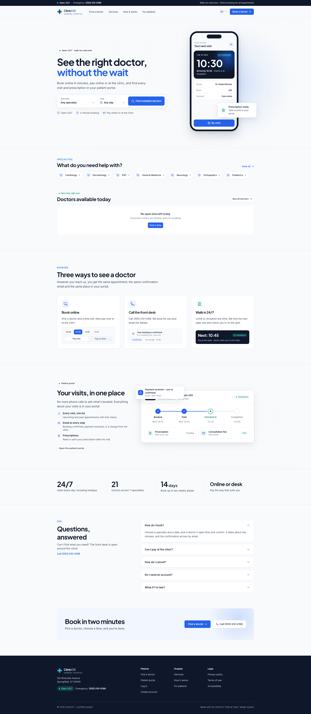
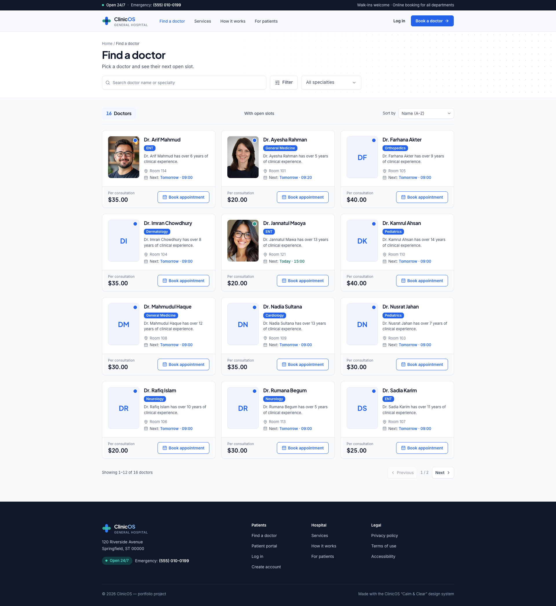
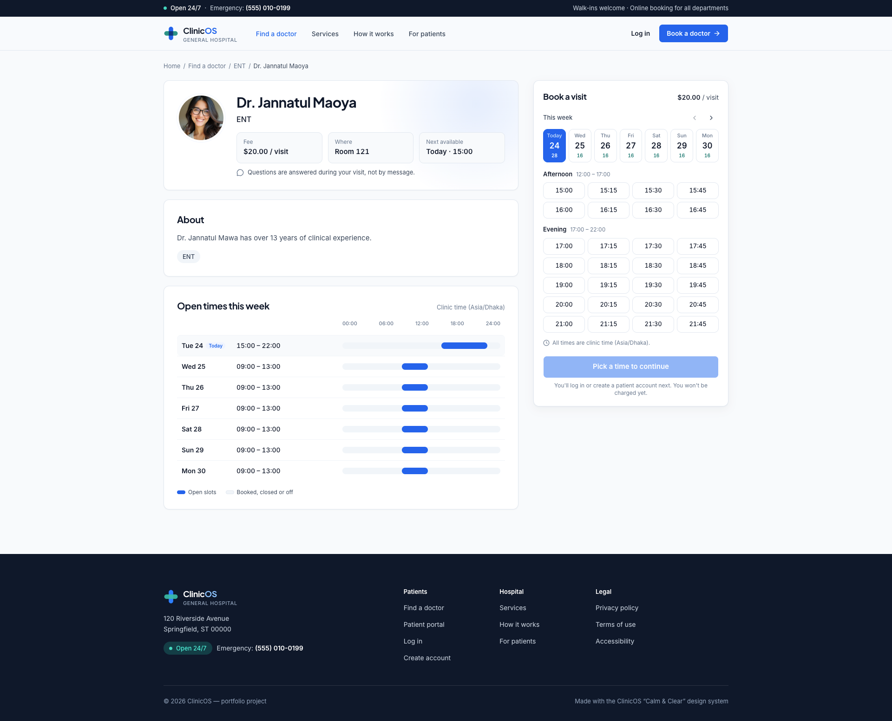
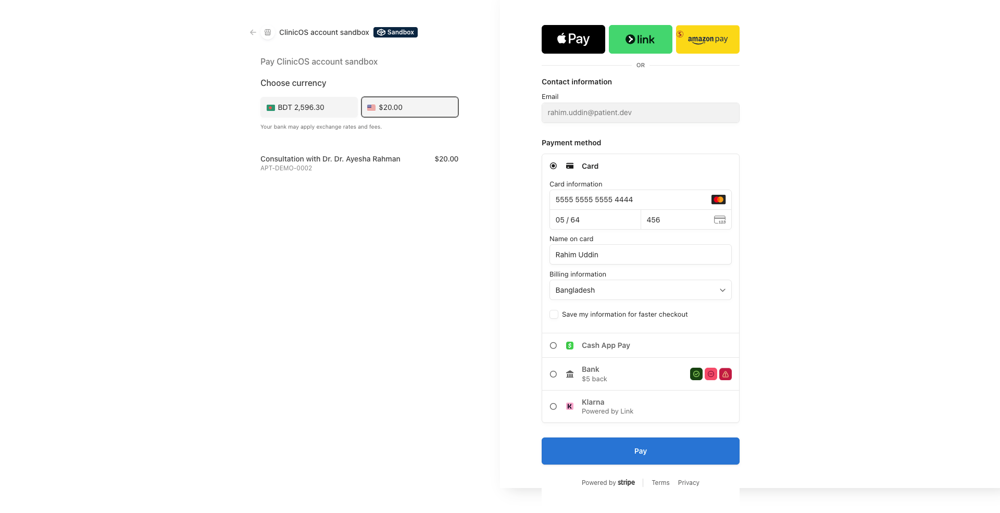
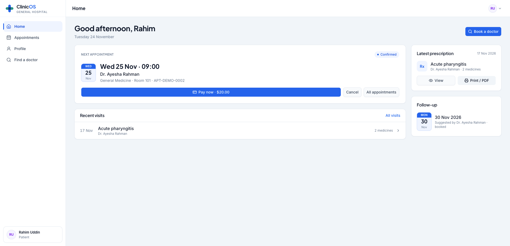
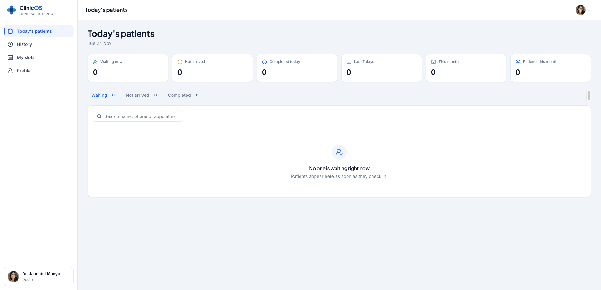
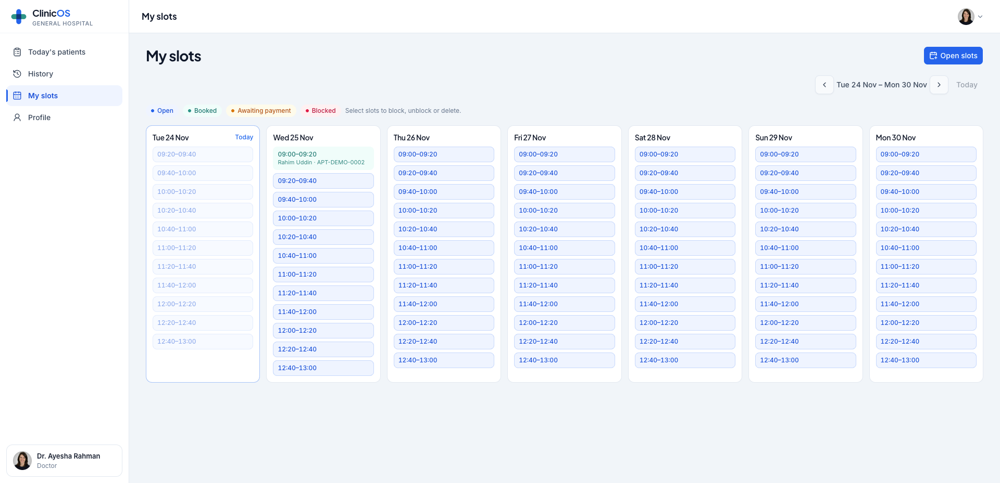
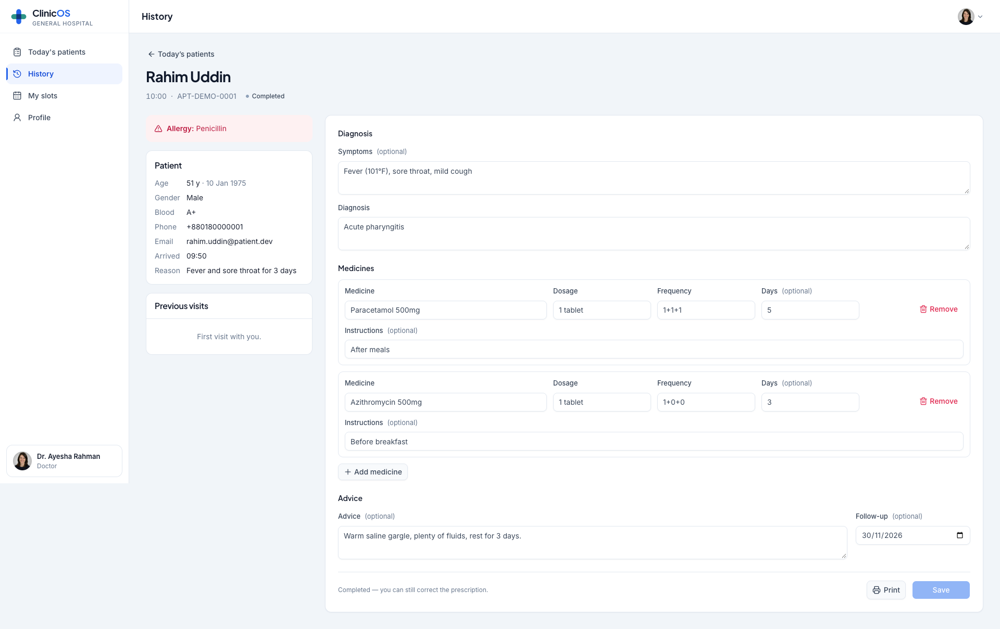
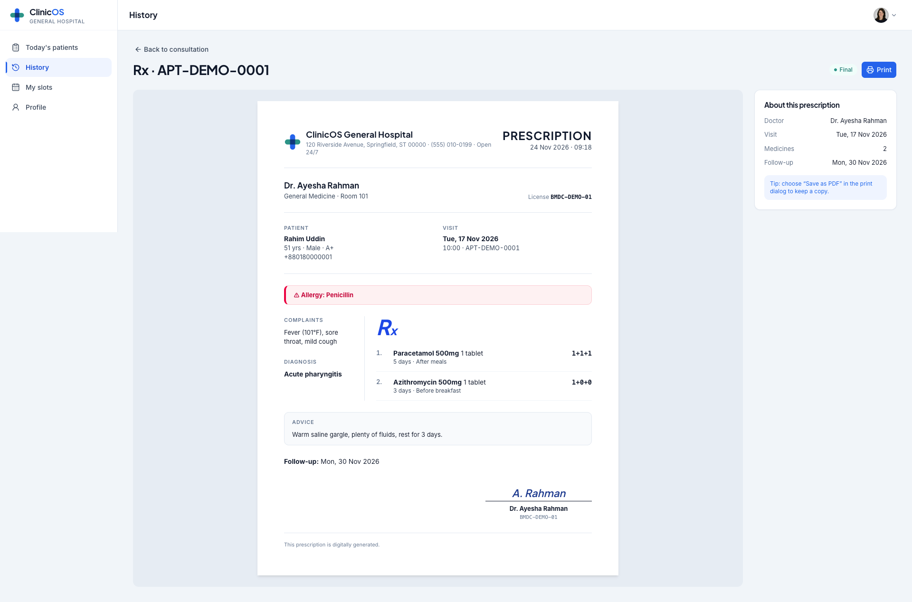
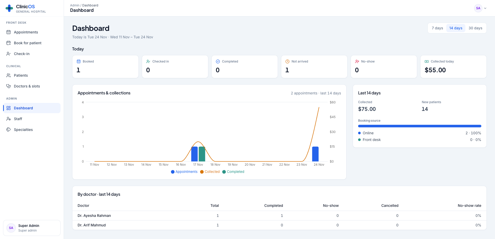

# ClinicOS

A full-stack clinic management system for a small to mid-sized clinic. Patients find doctors and book online, the front desk books walk-ins and checks patients in, and doctors run their day, write prescriptions and keep patient records.

**Live demo:** https://clinicos.dev.cv/
**API health:** https://api.clinicos.dev.cv/api/v1/health



---

## Demo accounts

The demo server is reset regularly, so feel free to click around.

| Role    | Email                          | Password    |
| ------- | ------------------------------ | ----------- |
| Doctor  | `dr.ayesha.rahman@clinicos.dev` | `Demo@1234` |
| Patient | `rahim.uddin@patient.dev`       | `Demo@1234` |

> Admin and super admin access is not public. See the admin screenshot below.

---

## Screenshots

### Public site and booking

| Find a doctor | Doctor profile and slot booking |
| --- | --- |
|  |  |

| Stripe checkout (sandbox) | Patient portal |
| --- | --- |
|  |  |

### Doctor

| Today's patients | Weekly slots |
| --- | --- |
|  |  |

| Consultation and prescription | Printable prescription |
| --- | --- |
|  |  |

### Admin



---

## Features

### Public site
- Home page with live doctors available today, specialties and FAQ
- Find a doctor: search, filter by specialty and availability, sort, paginate
- Doctor profile with open times and bookable slots

### Patient portal
- Sign up with email OTP verification, forgot and reset password
- Online booking with a slot hold and countdown, then Stripe payment
- Upcoming and past appointments, cancel, latest prescription, follow-ups
- Printable prescription and profile completion

### Doctor dashboard
- Today's queue with live stats (waiting, in consultation, done)
- Consultation screen with patient history, allergies and prescription writing
- Appointment history, slot management and profile photo upload

### Admin and front desk
- Staff management (admins, doctors) and specialties
- Front-desk booking for walk-in and phone patients, new patient registration
- Check-in, no-show and cancel flows, cash or online payment
- Slot management for every doctor and clinic-wide stats

### Platform
- Role-based access control: `SUPER_ADMIN`, `ADMIN`, `DOCTOR`, `PATIENT`
- Scheduled jobs (node-cron) that refill doctor slots and expire unpaid holds
- Transactional emails (verification, invites) with EJS templates
- All times stored in UTC and shown in the clinic's time zone

---

## Tech stack

| Layer    | Tech |
| -------- | ---- |
| Frontend | Next.js 16 (App Router), React 19, TypeScript, Tailwind CSS, shadcn/ui, TanStack Form and Table, Zod, Recharts |
| Backend  | Node.js, Express 5, TypeScript, Prisma 7, PostgreSQL, Better Auth, JWT cookies, Zod |
| Services | Stripe (payments and webhooks), Nodemailer (SMTP), Cloudinary (photos) |
| Security | Helmet, rate limiting, HTTP-only cookies, request validation |
| DevOps   | Docker, Docker Compose, GitHub Actions CI/CD, GHCR, VPS deploy |

---

## Architecture

```
Browser
   │
   ▼
Next.js web (apps/web)  ──server-side BFF──▶  Express API (apps/api)  ──Prisma──▶  PostgreSQL
                                                   │
                                                   ├── Stripe (payments, webhooks)
                                                   ├── SMTP (emails)
                                                   └── Cloudinary (photos)
```

The browser never calls the API directly. The Next.js server talks to the API with the user's cookies, so API URLs and secrets stay on the server.

```
clinicos/
├── apps/
│   ├── api/        # Express + Prisma API (modules: auth, admin, doctor, patient,
│   │               #   appointment, slot, payment, patient-record, specialty, stats)
│   └── web/        # Next.js app (public site, patient portal, doctor and admin dashboards)
├── deploy/         # Production docker-compose, env examples, deploy.sh
└── .github/        # CI and deploy workflows
```

---

## Getting started

### Requirements
- Node.js 24+
- pnpm
- PostgreSQL 17 (local or Docker)

### 1. API

```bash
cd apps/api
cp .env.example .env          # fill in DATABASE_URL, secrets, SMTP, Stripe test keys
pnpm install
pnpm migrate                  # run Prisma migrations
pnpm seed:superadmin          # create the super admin from .env
pnpm seed:demo                # optional: demo doctors, patients and slots
pnpm dev                      # http://localhost:5000
```

Generate each secret with `openssl rand -base64 32`.

### 2. Web

```bash
cd apps/web
cp .env.example .env
pnpm install
pnpm dev                      # http://localhost:3000
```

### Useful scripts (API)

| Script | What it does |
| ------ | ------------ |
| `pnpm check` | Prisma validate, typecheck and lint |
| `pnpm studio` | Open Prisma Studio |
| `pnpm migrate:deploy` | Apply migrations in production |

---

## CI/CD and deployment

- **CI** (`ci.yml`): on every push and pull request, installs, typechecks, lints and tests the API against a real Postgres service, and builds the web app.
- **Deploy** (`deploy.yml`): on push to `main`, runs CI, builds Docker images for `api` and `web`, pushes them to GHCR, then deploys to the VPS.
- **`deploy/deploy.sh`** pulls the images, starts the database, runs `prisma migrate deploy`, starts the apps and waits for the health check.
- **Rollback:** `IMAGE_TAG=<old git sha> ./deploy.sh`

---

## Author

**Md Arif Uddin** · [GitHub](https://github.com/arifucoder)
